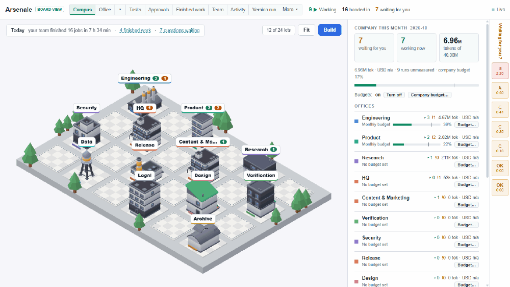
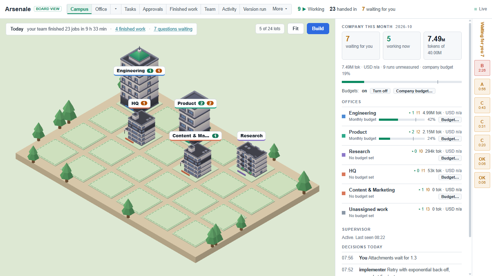
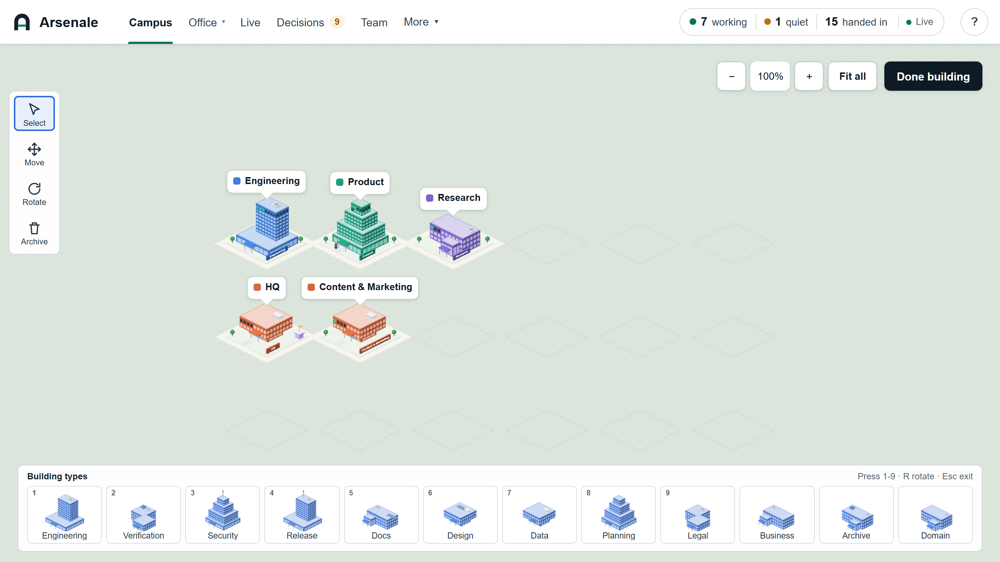
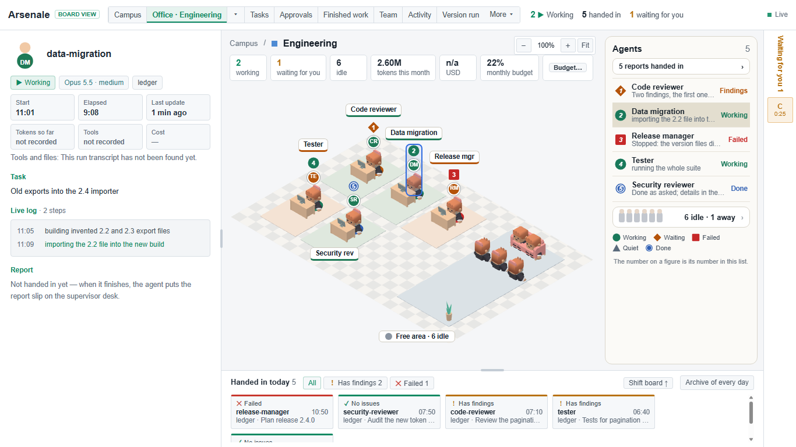
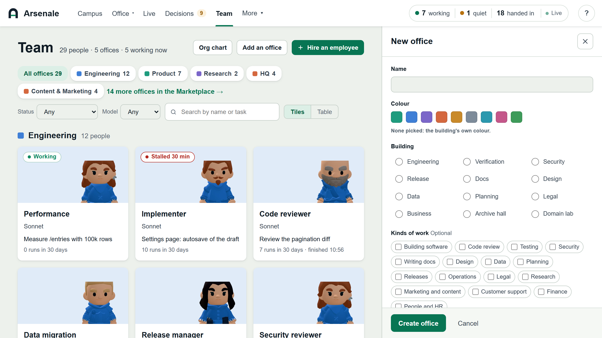
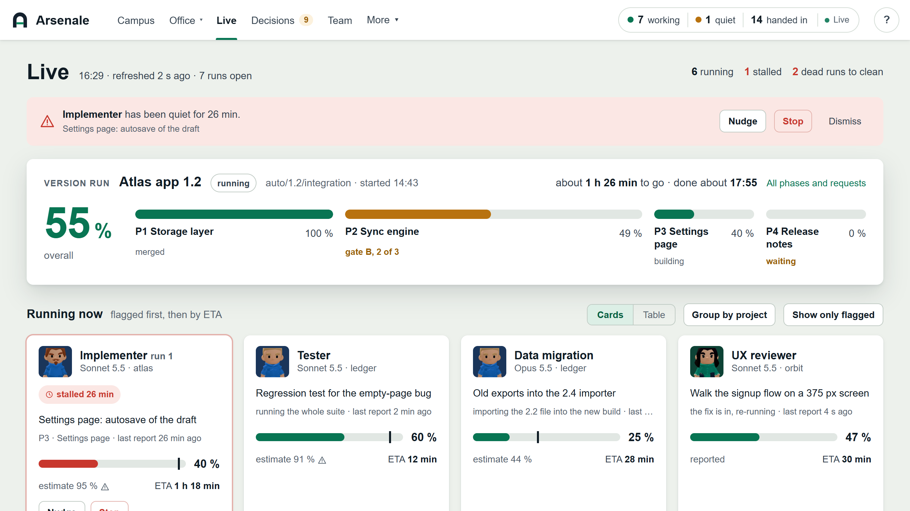
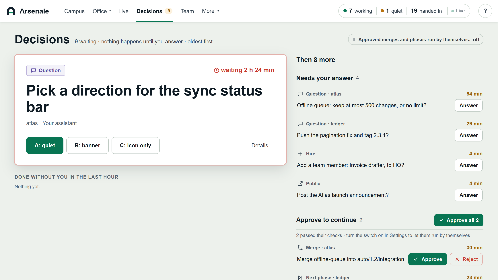
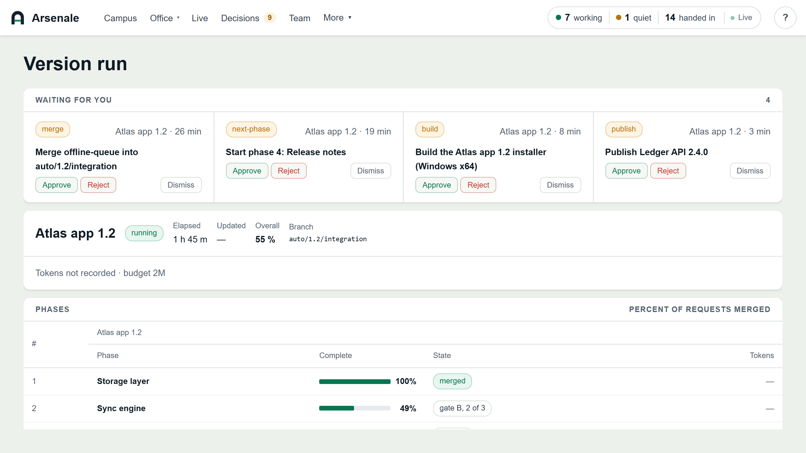
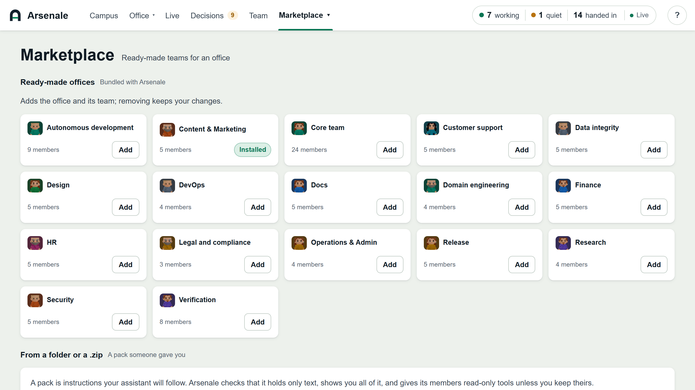
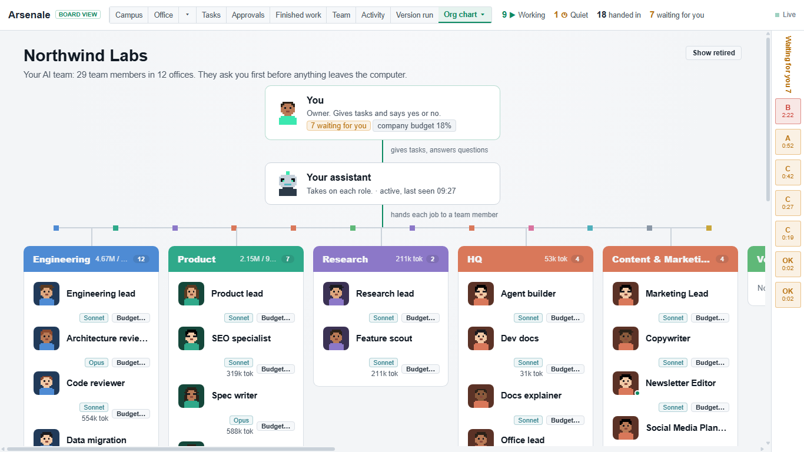

#  Arsenale

**Hire agents. Watch them work. Stay in charge.**

Arsenale is a local dashboard for coding agents. Your agents write a short log
of what they start, what step they are on and what they need from you.
Arsenale reads that log and draws it as a small company: a campus with one
building per team, an office with a desk for every agent, an org chart, and one
inbox for the questions that wait for you.

It only watches. It never starts, stops or controls an agent. Everything stays
on your machine.

It works with Claude Desktop, Claude Code, Cursor, VS Code, Codex, Gemini CLI,
Aider, or any script that can run a command.



[The same walkthrough as a video (MP4)](docs/media/arsenale-walkthrough.mp4)

## What you see

**Campus.** One building per office. A card above each building says who is
working and who is waiting. In build mode you place, move and rotate buildings
from a hotbar of 12 types.





**Office.** A 3D room with a desk for every agent. A person who is working,
waiting or stuck gets one small label. A run that goes quiet is flagged, and
the Needs a look box offers a Nudge.





**Live.** Every run that is working now, with its step, a percent, and the time
left. A run that has been quiet for 20 minutes is flagged.



**Decisions.** Every question and approval in one place, oldest first. Nothing
moves until you answer.



**Version run.** For a long job split into phases: progress for each phase,
the token budget, and the gates that wait for you.



**Marketplace.** Ready-made teams you can add to an office, or install from a
folder or a `.zip` someone gave you.



**Org chart.** You, your first agent, and every office with its people.



## Install

You need [Node.js](https://nodejs.org) 22 or newer and git.

Try it first. This shows an invented company in a temporary folder and never
touches your data:

```
git clone https://github.com/emadbarandan/Arsenale-Ai-Agent-Company.git
cd Arsenale-Ai-Agent-Company
node bin/arsenale.cjs demo
```

`demo --shop` shows a small shop with Marketplace packs instead.

To install it with npm:

```
npm install -g github:emadbarandan/Arsenale-Ai-Agent-Company
```

Or run the installer. It asks before every change, and `--dry-run` shows the
plan first:

| | Command |
|---|---|
| Windows | `powershell -ExecutionPolicy Bypass -File .\install.ps1` |
| macOS, Linux, Git Bash | `./install.sh` |

Then:

```
arsenale serve      # http://localhost:4310, opens your browser with your key
arsenale open       # open the running dashboard again
```

To remove it: `install.ps1 -Uninstall` or `./install.sh --uninstall`.

## Connect your agent

Open **Settings, Assistants** on the dashboard. Each tool has a card with the
exact command and a Test button. The adapters are in [adapters/](adapters/).

## What is new in 1.2

- **A new look.** One light theme with a tinted ground, white cards and larger
  text. The top bar has five screens, and the rest sit under More.
- **People who move.** The office, the campus and the lists show animated
  characters (see Licences).
- **Offices you make.** Create an office with a name, colour, building and
  kinds of work. Each run goes to the office that does that kind of work.
- **Marketplace.** A page of its own. Install a pack from a folder or a
  `.zip`; Arsenale checks that it holds only text and shows you all of it first.
- **Lighter labels.** In an office, only people who work, wait or need a look
  get a label.
- **A logo.** The arched gate, in the header and the favicon. Logo files, a
  profile picture and a reel cover are in `docs/brand/`.
- **For recordings.** A narrow layout for 9:16 video, and
  `arsenale demo --showcase`, which hides the legends and notes.

Older data opens in 1.2 without changes. The full list is in the
[changelog](CHANGELOG.md).

## Good to know

- Data is JSON files in `~/.arsenale`. The server listens on `127.0.0.1`.
  There are no accounts and no telemetry.
- Safety rules (`policy.json`) are advisory. Your agent is asked to check
  before an outside action, and you approve it on the dashboard.
- Notifications can go to the desktop and, if you set them up, to your phone
  (ntfy, Telegram, Pushover).
- `arsenale testq run --run <id> -- <command>` keeps a machine to one full
  test suite at a time.
- Long autonomous runs: `arsenale init`, then `arsenale autonomous start
  <version>`. `arsenale awake start --pid N` keeps a Mac or Linux machine awake
  while that process lives. The rules are in `autonomous/RULES.md`, and
  `arsenale log --help` lists the run fields.
- `arsenale --help` lists every command.

More: [full reference](docs/reference.md), [CONTRIBUTING](CONTRIBUTING.md),
[SECURITY](SECURITY.md).

## Licences

Arsenale is MIT licensed: see [LICENSE](LICENSE). The people are the KayKit
characters by Kay Lousberg, under CC0 1.0. The fallback character is made by a
script in this repo and is also CC0. Sources, hashes and changes are in
[tools/characters/LICENCES.md](tools/characters/LICENCES.md).

Version 1.2.0.
