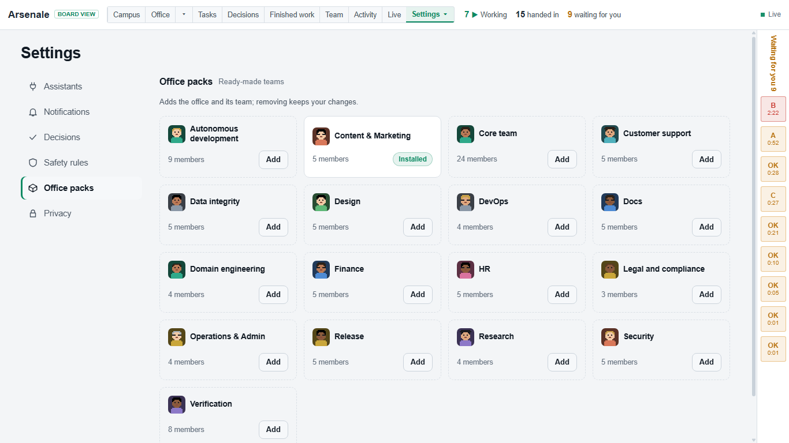

# Arsenale

**Run a company of AI agents you can watch at work.**

A local dashboard and run log for AI assistants (Claude Desktop, Claude Code,
Cursor, Codex, Gemini CLI, Aider, your own scripts). The assistant logs what it
does; Arsenale draws it as an office, a campus, an org chart and a list of the
questions waiting for you. It watches; it never runs agents.





## Quick start

Needs [Node.js](https://nodejs.org) 20 or newer and git.

```
git clone https://github.com/emadbarandan/Arsenale.git
cd Arsenale
node bin/arsenale.cjs demo
```

`demo` shows an invented company in a temporary folder and never touches your
data. `demo --shop` shows a small shop with office packs.

To install it, run the installer (it asks before every change; `--dry-run`
shows the plan):

| | Command |
|---|---|
| Windows | `powershell -ExecutionPolicy Bypass -File .\install.ps1` |
| macOS, Linux, Git Bash | `./install.sh` |

Then:

```
arsenale serve      # http://localhost:4310, opens your browser with your key
arsenale open       # open the running dashboard again
```

## Connect your assistant

Open **Settings, Assistants** on the dashboard: each tool has a card with the
exact command and a **Test** button. Adapters for each tool are in
[adapters/](adapters/).

## Good to know

- Local only: JSON files in `~/.arsenale`, a server on `127.0.0.1`, no
  accounts, no telemetry.
- Safety rules (`policy.json`) are advisory: your assistant is asked to check
  before an outside action, and you approve on the dashboard.
- **Live** shows every run working now, with its step, a percent and the time
  left; a run that goes quiet is flagged, and one whose process ended is
  closed. **Decisions** collects every question and approval in one inbox.
- Notifications on the desktop and, optionally, on your phone (ntfy, Telegram,
  Pushover), set up and tested in Settings.
- `arsenale testq run --run <id> -- <command>` keeps to one full test suite at
  a time on a machine.
- `arsenale --help` lists every command.
- Autonomous runs: `arsenale init`, then `arsenale autonomous start <version>`; `arsenale awake start --pid N` keeps a Mac or Linux machine awake while that process lives. The essential rules are in `autonomous/RULES.md`; `arsenale log --help` lists the run fields (`versionRun`, `phase`, `pid`, `tier`).
- Uninstall: `install.ps1 -Uninstall` or `./install.sh --uninstall`.

More: [full reference](docs/reference.md), [CONTRIBUTING](CONTRIBUTING.md),
[SECURITY](SECURITY.md). Version 1.1.0. License: [MIT](LICENSE). The default character is made by our own script and is CC0 ([tools/characters/LICENSE.txt](tools/characters/LICENSE.txt)).
